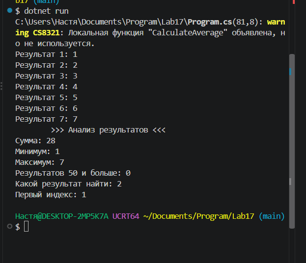

# Практическая работа №17
Автор: Анастасия Пономарева 
Группа: ИСП-252

## Тема
Алгоритмы обработки массивов.

## Что реализовано
- сумма элементов;
- подсчёт элементов по условию;
- минимум и максимум;
- линейный поиск;
- поиск первого индекса.

## Короткие ответы
1. Почему максимум нельзя всегда начинать с `0`?
Ответ: Искажение ответа при работе с отрицательными числами.

2. Что означает `-1` после поиска индекса?
Ответ: -1 означает, что число не найден в массиве.

3. Чем сумма отличается от подсчёта элементов?
Ответ: Сумма находит значение всех элементов при сложении. Подсчёт элементов просто считает их количество.

## Результат

